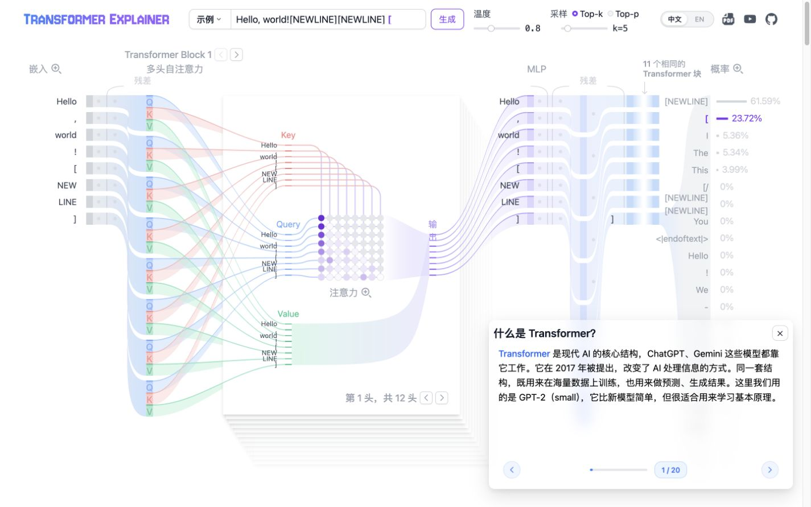

# 启动优化实测与交付记录

日期：2026-10-13。按用户要求在当前范围收尾；保留原有 5173 服务。

## 原因与本次修改

终端大多数输出来自 Sass 弃用、未使用样式/属性和无障碍警告，并不是模型运行失败。真实慢点是读取约 626.24 MiB 的 63 个本地模型分片、合并并初始化浏览器模型。

本次完成：SCSS 注入改用 `@use`；组件和图标改用已安装包的公开按需入口；清理组件警告并补齐类型；更新两个浏览器兼容数据包；声明现有 Apple 图标；减少 Blob/对象 URL 中转；共享进行中的模型加载；处理缓存不可用和写入失败；展示分阶段进度和失败重试；补齐卸载时事件、观察器、计时器、动画和会话清理。

保留 GPT-2、全部 63 个分片、721 个教学输出、本地分词器、本地 WASM、中文默认和英文内容。

## 性能对照

环境：本机 macOS，Codex 内置 Chromium 浏览器，Node v26.11.1、npm 11.20.0，Vite 6.4.4、ONNX Runtime 1.23.0。比较原版备份构建与加载优化版构建；同一默认浏览器尺寸。每种状态各 3 次；首次加载使用新端口隔离缓存，不清空用户缓存。下表是导航至真实模型会话就绪的中位数与范围，不是开发服务器启动时间。

| 状态               | 原版                  | 优化版                | 中位数缩短 |
| ------------------ | --------------------- | --------------------- | ---------- |
| 未命中模型缓存     | 6.63 秒（6.52～6.95） | 5.78 秒（5.70～6.01） | 12.8%      |
| 63/63 分片缓存命中 | 2.01 秒（1.92～2.40） | 1.43 秒（1.28～1.46） | 28.5%      |

模型初始化阶段的中位数：首次从 1.39 秒降至 0.71 秒，缓存刷新从 1.33 秒降至 0.66 秒。首次加载未达到计划中争取 20% 的目标，仍受模型读取体积影响。本次没有加入额外并发限制、量化或 GPU 方案。

原始样本见 [startup-samples.json](qa/startup-samples.json)。使用 `?startupDebug=1` 可查看分阶段加载和固定输入推理诊断；默认关闭，仅写本地控制台。

## 已完成验证

- 最终完整项目检查：0 个类型错误、0 个警告；修改前为 501 个错误、85 个警告。未关闭严格检查或添加批量警告屏蔽。
- 27 项测试全部通过，包括分片顺序、HTTP 失败、缓存降级、初始化重试、所有权与进行中推理释放时机。
- 最终生产构建成功。按需组件入口消除了未使用 Carousel 带来的提示。
- 固定输入 `Hello, world!`：token ID 为 `[15496,11,995,0]`；721 个输出名称及尺寸与原版完全一致，前 8 个 logits 差值为 0。
- 真实浏览器自定义推理、连续两次点击生成均完成，最后恢复可生成状态。
- 仅允许同源连接的 CSP 测试服务中，禁用 Cache API 仍能就绪并实际推理。
- 模拟分片 404：显示错误、停止等待、禁止真实生成；恢复文件后，同一页面重试成功。没有修改项目的模型资源文件。
- 模拟统计调用抛错：模型仍完成加载并启用生成。
- 独立规格和质量审查已完成；审查发现的启动抢焦点、重试清除运行锁、分词器失败后示例仍可选问题已修复。

## 验证边界与保留事项

- 用户要求收尾，因此没有继续做 Safari、手机、完整三次热更新及所有展开/收起路径测试。已修复卸载问题并经过代码审查，但不宣称这些浏览器场景全部验证。
- 未实测内存峰值，不能将去掉中转等同于零复制。
- 构建仍有依赖层提示：SvelteKit/Rollup 的 `codeSplitting` 选项、Transformers.js 内部 ONNX 的 `eval`、大包尺寸提示。构建成功；没有升级整套框架或屏蔽这些提示。
- 最初开发模式单次 9.27/5.95 秒数据只作定位参考，不与本表生产构建数据混用。
- 当前目录没有 Git，原始源代码备份保存在 `/private/tmp/transformer-optimization-20261013/source-before.tar.gz`。临时备份不是长期版本管理。
- 指定的两个 OpenCode Go 模型因提供商访问拒绝而不可用，GPT-6 Luna 不支持 ultra，实际执行模型为 GPT-6 Luna max；没有悄悄改用其他主力模型。
